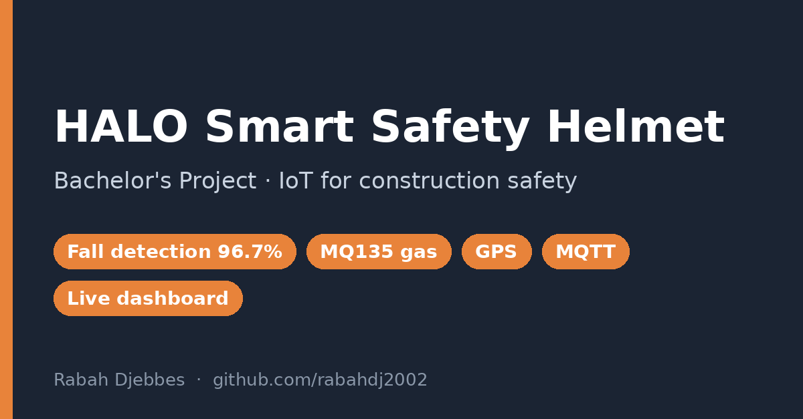
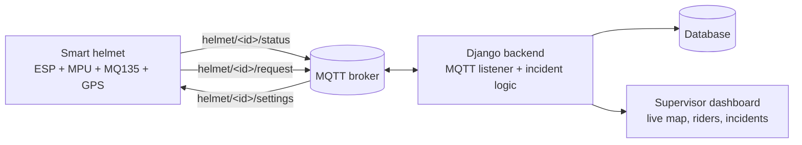

# HALO – Smart Safety Helmet



**An IoT safety helmet for construction workers, with a real-time supervisor dashboard.**
The helmet detects falls and crashes, measures gas/alcohol levels and tracks GPS position, then streams everything over MQTT to a Django web platform where supervisors monitor every worker live and receive instant incident alerts.

> Bachelor's final-year project – Control Systems Engineering, University of Constantine 1 (2024).

---

## Highlights

- **Fall and crash detection** from the helmet's MPU (accelerometer and gyroscope), with **96.7% detection accuracy** in testing.
- **Gas and alcohol monitoring** with an MQ135 sensor; configurable threshold triggers an automatic alert.
- **GPS tracking** with full route history per worker.
- **Helmet status**: worn/strapped detection, tilt angle, battery level, Wi-Fi signal (RSSI) and latency from the ESP module.
- **Priority status logic**: `Accident > Drunk > Online > Offline`, so the most critical state is always shown first.
- **Incident management**: automatic incident records with location, plus resolve/acknowledge workflow.
- **Remote configuration**: helmets request their settings (alcohol limit, speed limit, refresh rate) over MQTT at startup.
- **In-app MQTT protocol docs** for firmware developers.

## Architecture



## Tech stack

| Layer | Technologies |
|---|---|
| Helmet hardware | ESP microcontroller, MPU (IMU), MQ135 gas sensor, GPS module, battery |
| Messaging | MQTT (paho-mqtt), WebSocket Secure for the browser |
| Backend | Python, Django 5.1, Gunicorn |
| Database | SQLite (development), PostgreSQL-ready (`psycopg2`) |
| Reports | ReportLab (PDF), openpyxl (Excel) |
| Deployment | Docker, Linux server, Cloudflare |

## MQTT protocol

**Helmet → platform**: publish telemetry to `helmet/<helmet_id>/status`

```json
{
  "lat": 36.365, "lon": 6.614, "speed": 4.2,
  "alc": 0.02, "tilt": 12.5,
  "worn": true, "strapped": true,
  "bat": 87, "rssi": -61, "latency": 120
}
```

**Helmet requests its settings**: publish `{"type": "get_settings"}` to `helmet/<helmet_id>/request`.
The platform replies on `helmet/<helmet_id>/settings`:

```json
{ "allowed_alcohol_level": 0.5, "speed_limit": 60, "refresh_rate": 5 }
```

## Dashboard pages

| Page | Purpose |
|---|---|
| Dashboard | Live map and status of every helmet |
| Riders | Worker list, rider details and route history |
| Incidents | Crash and alcohol alerts with location |
| Settings | Safety thresholds, speed limit, map refresh rate, MQTT broker |
| MQTT docs | Protocol reference for helmet firmware |

## Quick start

```bash
python -m venv venv
source venv/bin/activate          # Windows: .\venv\Scripts\Activate.ps1
pip install -r backend/requirements.txt

cd backend
python manage.py migrate
python manage.py createsuperuser
python manage.py runserver 0.0.0.0:8000
```

The MQTT listener starts automatically with the server. Set the broker host and port on the **Settings** page.

To test without hardware, run the telemetry simulator:

```bash
python simulate_telemetry.py
```

## Remote hosting

1. Add your domain to `CSRF_TRUSTED_ORIGINS` and `ALLOWED_HOSTS` in `smarthelmet/settings.py`.
2. Set the **Public WebSocket Host** on the Settings page.
3. Make sure the MQTT broker accepts WSS (port 443 works well behind Cloudflare).

## Author

**Rabah Djebbes** – Automation & Control Engineer
[LinkedIn](https://www.linkedin.com/in/rabahdjebbes) · [GitHub](https://github.com/rabahdj2002) · Rabahwork@gmail.com

## License

Proprietary – all rights reserved.
